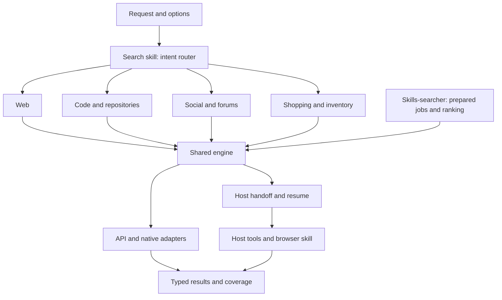

# Search skill and shared retrieval engine

Build `utils-agent:search` to retrieve and verify web, code, social and shopping evidence through available APIs, native tools and browser workflows. A shared engine owns adapters and execution; the host agent chooses relevant areas and judges evidence. Sources are optional. The system works without a self-hosted index and preserves useful partial results when access is missing.

`skills-searcher` becomes a consumer of the same engine, retaining skill-specific query construction, ranking and installation guidance. Research skills retain synthesis; the existing browser skill retains runtime selection, identity and resource cleanup. Provisioning accounts, purchasing, publishing and operating permanent services are outside the search workflow.

## Implementation status

The shared engine, four-area skill and skills-searcher migration are implemented
under [search](../../agent-marketplace/packages/utils-agent/skills/search/SKILL.md).
[ADR 0054](../adr/0054-shared-search-engine.md) records the accepted boundary.
The [qualification record](../research/search-skill-implementation.md) distinguishes
contract tests, current live access, packaging, activation and unmeasured task quality.

Inspection URLs become known after discovery. The implementation adds `extend`
to append prepared inspection jobs without resetting the run's budget/deadline,
and `assess` to record the host's facet evidence checks. `select` records candidate
fit, verification, shortlist reasons and omissions using the shared
[selection contract](../../agent-marketplace/packages/utils-agent/skills/search/references/selection.md). Automatic private XDG checkpoints and transport events span discovery, enrichment,
inspection and selection, including skills-searcher. Candidate pages and fetch
budgets are separate from the final result limit. Provider routing is not a
semantic relevance ranking.

The [source-selection follow-up](search-source-selection-plan.md) builds on the
1.15.0 implementation with multilingual and regional guidance, broader shopping
channels and explicit site scopes, implemented in 1.16.1. Its
[qualification record](../research/search-source-selection-qualification.md)
separates contract/review evidence, the 45-attempt development pilot and native
activation. Both plans retain broader task-quality gates: the small pilot does not
establish superiority, translation correctness or independent generalization.

## Evidence behind the design

| Finding | Design consequence |
| --- | --- |
| [API trials](../research/search-index-first-run.md) used different request schemas and query languages; native GitHub/grep.app found checked code that broad web queries missed | Implement adapters and source-specific operations; verify code at a revision |
| [Website trials](../research/search-index-website-run.md) reached Startpage/DDG, but also encountered 429s, opaque redirects and generic off-source results | Support browser handoffs; distinguish parsed candidates from useful evidence |
| [Vertical probes](../research/search-index-second-run.md) returned products and videos without proving delivery availability or correct channel/content | Keep discovery, inspection and task completion separate |
| [Degoog diagnostics](../research/degoog-metasearch-reliability.md) exposed challenge pages reported as empty and partial engine failure | Preserve native failure states and per-source outcomes |

The existing corpus has 78 historical cases, 27 core queries, nine platform discovery probes and 18 richer platform tasks. These are development evidence, not a hidden test set. Retrieval counts have not established a relevance winner; API and browser timings from different dates are not controlled comparisons. The [evaluation protocol](../research/search-index-eval.md#how-to-use-the-corpus) owns the detailed methodology.

## Architecture and ownership



The host agent selects one or more areas, decomposes the task into evidence facets, and emits a structured request. It uses its existing reasoning capability. The engine resolves that request against capabilities, choices, health and budgets; it executes supported jobs or returns host work. `skills-searcher` supplies prepared jobs directly, without a second intent-routing pass.

| Area | Policy owned by the skill |
| --- | --- |
| Web | Entities, primary sources, keyword/semantic intent, date/version and destination checks |
| Code | Repository versus issue/comment versus code search; paths, revisions and production-versus-test usage |
| Social | Author/channel/community, date window, comments/transcripts and engagement provenance |
| Shopping | Product/variant, seller, condition, price/currency, MOQ, location, shipping and live availability |

Areas follow the requested evidence: Marketplace listings are shopping; owner reviews may be social. A source can support discovery while lacking comments, transcripts or address-specific offers.

Keep **area**, **source**, **provider**, **upstream**, **method**, and **operation** distinct. For example, Serper retrieves Google-indexed Reddit candidates: area `social`, source `reddit`, provider `serper`, upstream `google`, method `api`, operation `post.discover`. This does not imply native Reddit comment access. Upstream is `unknown` unless established; shared upstreams do not count as independent corroboration.

The host supplies terms and structured filters; adapters own provider syntax and translation. A prepared native query must declare its adapter dialect and use the same validation path, bypassing automatic syntax translation. This supports skill-specific Sourcegraph queries without appending filters twice.

## Capabilities and route selection

Adapter metadata is the source of truth for supported operations, filters, credentials, method and upstream. Resolve credential presence through the configured host/environment bridge, rather than checking one file. Track three separate dimensions:

| Dimension | States/data |
| --- | --- |
| Readiness | Configured but unverified, missing credential/tool, requires host, disabled, unsupported |
| Observation | Timestamp and last success, empty, partial, timeout, rate limit, challenge, auth failure or schema error |
| Coverage | Facet supported, discovery-only, unverified, unavailable or excluded |

Local discovery performs no source requests. The first real request supplies current health evidence; `doctor --live` explicitly requests budgeted probes. A configured credential or keyless endpoint does not establish working access. Missing optional sources yield partial coverage. Missing required evidence makes completion false while preserving independent useful results.

Resolve routes in this order: supported operation and filters; user constraints; usable capabilities; strategy and observed health. Native GitHub and HN routes take priority for their operations. General web defaults to `free-first`: eligible host search or Startpage/DDG before authorized paid fallback. `balanced` can prefer a configured API to avoid browser startup. Serper serves keyword discovery, Exa semantic discovery, and Brave an independent-index option; these are provisional roles, not quality rankings.

A failed/empty/off-constraint result permits one useful query repair or another eligible route within budget. Fallback preserves hard constraints. Rate-limit, challenge and login responses stop that route; a transient timeout/5xx may consume one retry. Search stops when evidence requirements are satisfied or the budget is exhausted.

## Guidance during use

Provide a short suggestion when an observed capability gap materially limits the answer or a repeated workflow exposes a useful extension. Lead with the result and its coverage. Then explain the gap, what an improvement would enable, and the smallest next step. Successful ordinary searches need no extension advice.

Distinguish configured-but-failing access, supported-but-unconfigured access, and an operation the engine does not implement. Suggest a diagnostic for a transient failure, existing setup guidance for missing access, or an adapter/workflow extension for missing capability. Ground setup advice in current registry metadata and verified documentation; label untested possibilities. A source's existence alone does not justify a recommendation or promise better results.

For example: “I found relevant Reddit threads, but could not read their comments. A configured comments-capable route would let me check the detailed replies; this result covers thread discovery only.” A development suggestion should identify its proposed source/operation and owning file or skill. Return these as optional structured `suggestions` in JSON as well as concise prose. Each suggestion carries the observed gap, expected benefit, next step and prerequisites. Avoid repeating a suggestion after the user declines it within the conversation.

Suggestions do not change source configuration, save preferences or modify skills. When the user requests the proposed extension, use the repository's skill-management workflow. Keep extension details in `references/extending.md`, reached from `SKILL.md` when adding a source/provider or deciding whether to create a specialized skill; ordinary queries do not load that guide.

## Adding sources and specialized skills

Choose the smallest extension that supplies the missing behavior:

| Need | Owner and change |
| --- | --- |
| Enable an existing supported route | Host configuration/credential bridge; no skill or adapter rewrite |
| Search another site through an existing provider | Source declaration and structured domain filters in `searchlib`; add identity/parser rules only where needed |
| Use a new API, CLI, MCP or browser result format | `scripts/searchlib/adapters/<provider>.py` and any parser; register its supported operations, filters, prerequisites and failures |
| Verify evidence from a source | The relevant `references/{web,code,social,shopping}.md`; disclose substantial source-specific guidance in a linked reference |
| Improve retries, health, budgets, normalization or host handoffs | Shared engine; keep one implementation for every caller |
| Perform a distinct domain workflow over retrieved evidence | A specialized skill beside search, consuming its request/result contract |

Adapter modules own their capability metadata; the registry assembles it without duplicating it in prose. An adapter can serve multiple sources, and a source can have several adapters. Adding a source does not create another area, require another key, or imply native search: declare exactly which operations the route supports.

For an extension, first record a representative public request, missing operation, access requirements and expected evidence. Reuse an existing route where possible. Then add the smallest declaration/adapter and area guidance needed. Completion requires contract fixtures for success, empty and relevant failures, an unavailable-source case, and a live canary when access and permitted use allow it. Report unverified access explicitly. A new route is eligible for selection only when configured and permitted; preferential routing requires evidence of benefit. Package changes receive the normal version bump and validation.

Keep a workflow in the parent when ordinary search requests need the same retrieval or evidence-checking behavior. Create a specialized skill when users have a distinct recurring intent with its own decisions, output or completion criteria. For example, `skills-searcher` adds SKILL.md/frontmatter queries, authority/popularity judgments and preview/install guidance. A future literature-review skill could add paper-selection criteria and a synthesis format while reusing shared scholarly retrieval adapters. A provider name, one site restriction or a saved query is not enough reason to create a skill.

A specialized skill owns its triggers, query policy, domain judgments, output and task evals. It sends structured requests or prepared jobs to search and consumes its results/coverage; it reuses shared auth, execution, budgets and failure handling. Keep dependencies explicit in packaging and preserve partial-source behavior. Add a separate model-invoked description only when the workflow needs independent discovery or another skill must invoke it. Otherwise use an area reference or saved choices. General improvements discovered in a specialized workflow belong back in search; its domain decisions stay with the caller.

## Invocation and preferences

Use model invocation with a short description: “Search web evidence, repositories/code, social discussions and product listings. Use for targeted discovery and the retrieval step of a research task.” Keep the common workflow in `SKILL.md` and load area references only when selected.

| Option | Contract |
| --- | --- |
| `--area=web,code,social,shopping` | Restrict areas; omitted means host selection |
| `--source=reddit,youtube` / `--exclude-source=x` | Include/exclude evidence sources; incompatible source/area or contradictory selections are resolution errors |
| `--require-source=reddit` | Require usable evidence from that source for completion; does not obtain new access |
| `--provider=serper` / `--via=api` | Pin provider or method (`api`, `native`, `browser`, `host`; `auto` leaves it open) |
| `--prefer-provider=serper` / `--prefer-via=api` | Prefer a route while allowing eligible fallback |
| `--browser=camofox` | Require that browser runtime through the browser skill |
| `--strategy=free-first\|balanced` / `--free-only` | Choose ordering; free-only excludes chargeable or unknown-cost routes, regardless of trial balances |
| `--since`, `--until`, `--location` | Date and public geographic filters; private delivery context stays in the authorized native/browser session |
| `--limit=10` / `--total-limit=30` | Per-facet and total returned-candidate caps, respectively |
| `--max-calls`, `--max-opens`, `--timeout` | Run-wide adapter-call, source-open and elapsed-seconds caps |
| `--inspect` / `--json` | Resolve and explain without source calls/writes; JSON selects structured output |
| `--show-defaults`, `--save-defaults`, `--reset-defaults` with `--scope=user\|repo` | Inspect, explicitly persist or clear choices at the named scope; default user scope; show/reset stop afterward |

```text
$search "Go runtime.GC production call sites" --area=code
$search "8BitDo reliability and current offers" --area=social,shopping
$search "portable monitors" --via=browser --browser=camofox --free-only
$search "agent tooling" --prefer-provider=serper --inspect
$search --show-defaults --scope=repo
```

Natural language has equal authority: “use X” pins; “try X first” prefers. Every choice records its value, constraint/preference kind, origin and scope. Saving preserves that kind, including hard free-only/runtime/provider constraints. Resolve current explicit choices, applicable conversation decisions, repository preferences, user preferences, then defaults; contradictions within one level are errors. A stale saved constraint blocks dependent work; a stale preference is reported and omitted.

User choices live at `${XDG_CONFIG_HOME:-~/.config}/agent-search/preferences.json`; repository choices use `.agents/search.json` at the Git root. Save only explicit selections, with versioned atomic writes. Preferences contain no credentials, private addresses, query history or executable commands and confer no new authorization. Inspect plus save/reset is invalid; scope alone requests no write.

## Engine and host protocol

Ship a Python 3.14+ standard-library package with `scripts/agent-search` using `uv run --script`, matching the existing skill-search runtime. Keep the adapter registry fixed in-package; configured external CLIs remain optional. Declare any future Python dependencies through the repository/package workflow and PEP 723 metadata.

```text
agent-search capabilities --json
agent-search doctor [--live] [--provider=...] --json
agent-search plan --request request.json --capabilities host.json
agent-search run --plan plan.json --state state.json --json
agent-search continue --state state.json --host-results results.json --json
agent-search query "terms" --area=web --provider=serper --json
```

`query` invokes the same resolver and runner as `plan` plus `run`. All request, capability, plan, state and result documents carry a schema version; unknown fields/IDs and incompatible constraints fail before dispatch.

| Boundary | Required content |
| --- | --- |
| Request | Public terms/facets, areas, sources, operation, structured filters or declared native-query dialect, evidence needs, choices, budget |
| Capability | Adapter ID/version, methods, source/operation/filter support, upstream, prerequisite names, retention policy and health observation |
| Plan | Facet/job IDs, translated queries, eligible route/fallback conditions, choice origins and allocated budgets |
| State | Run/plan identity, jobs and attempts, completed results, outstanding host work, reservations, consumed budget and fixed deadline |
| Result | Typed resource identity, source/provider/upstream, observed time, rank, excerpt, native fields, retrieval outcome, evidence level and usage |
| Report | Results plus per-facet coverage, unresolved constraints, skipped/failed sources, completion flag, pending host work and optional gap-driven suggestions |

The host creates `host.json` from its actual tool inventory. Each entry names a capability (`web.search`, `web.fetch`, `browser`, `mcp:grep.app`), callable tool binding, supported operations and any runtime/identity limits. Discovery records capability without implying authentication. A standalone CLI with no host declaration returns `requires_host` for those jobs.

The runner checkpoints atomically before emitting host work with `{run_id, work_item_id, attempt_id, operation, payload, reserved_budget}`. The host executes through the named tool/browser skill and returns `{run_id, work_item_id, attempt_id, status, payload, usage, observed_at}`. Validated parsed results are preferred; provider-specific DOM/snapshot payloads pass through parsers in `searchlib`. The browser skill owns interaction and cleanup, not search-result parsing.

`continue` validates run/attempt IDs, reconciles reserved usage, accepts each result once and runs remaining eligible jobs. Duplicate submissions are idempotent; unknown/stale attempts are rejected. Interrupted work remains unresolved until its outcome is reconciled, avoiding automatic replay. Continuation preserves the original deadline and budget. A locked, versioned state file prevents concurrent writers; unknown host usage conservatively consumes its reservation. Host tools are cooperative participants, so report unobservable internal fan-out as unknown rather than claiming a billing guarantee.

Adapters declare credential environment names, including `SERPER_API_KEY`, `EXA_API_KEY` and `BRAVE_SEARCH_API_KEY`. A host bridge resolves approved credentials into the adapter subprocess environment and reports presence/source metadata separately. Portable code carries no vault identifiers or host paths; secret values stay out of arguments, state, logs and results. Paid routes require existing authorization and configured account limits or prepaid allowance.

## Identity, evidence and budgets

| Resource | Canonical identity |
| --- | --- |
| Repository | Host + canonical owner/repository |
| Code file/match | Repository + path + revision; retain match spans within a file; unknown revisions remain distinct from known ones |
| Issue/comment | Repository/platform + item ID + comment ID where present |
| Post, video, HN item | Platform + native ID; preserve YouTube `v` and HN `id` |
| Product/listing | Marketplace + native product/listing ID + variant |
| Offer | Product identity + seller + condition + location + observation time |
| Web page | Resolved URL with identity-bearing parameters; opaque destinations remain unresolved |

Group only matching identities; preserve provider ranks and each observation's provenance. Conflicting prices, dates or versions remain separate observations. The generic engine never takes a numeric maximum as truth. Skills-searcher's compatibility output retains its existing `(repo,path)` / `(repo,skill-name)` / `(url,name)` grouping and metric merge policy, implemented in the domain consumer over engine observations.

Adapters emit candidates. Source inspection adds evidence references and per-facet checks; only the host's recorded evidence assessment can mark a facet supported. Empty provider payloads inside 2xx map to empty, detected challenges to challenge, and generic off-source results to constraint failures. A result URL alone never verifies recency, authorship or orderability.

Budget fields are `{calls, discovery, enrichment, opens, wall_seconds}`. Discovery and enrichment draw from the shared `calls` cap. Interactive defaults: three calls, split two discovery/one enrichment; five when code is selected, split three discovery/two enrichment. Each additional area adds two discovery slots up to eight total calls. Opens default to six and wall time to 120 seconds. `--max-calls` replaces the total cap, `--max-opens` the open cap, and `--timeout` the deadline; the resolver reserves one enrichment slot, or two when code is selected, bounded to leave one discovery slot, and assigns the remainder to discovery. Inspection-only requests allocate their calls to enrichment. Explicit structured budgets can choose a different split within the selected call/open/time limits; conflicting larger budgets are rejected. The resolved allocation is displayed before execution.

The engine owns reservations across native, API and host jobs. Reserve before dispatch, count retries/enrichment, and settle reported usage once. Cap concurrent independent jobs at two initially and serialize against provider rate limits. These caps count adapter/tool operations, not opaque internal HTTP traffic. Known fan-out must be declared and capped separately. Broader research and skills-searcher provide explicit budgets rather than inheriting interactive defaults.

## Implementation sequence

Author under `agent-marketplace/packages/utils-agent/skills/search/`: `SKILL.md`, `agents/openai.yaml`, `references/{web,code,social,shopping,options,extending}.md`, `scripts/agent-search`, focused `scripts/searchlib/` adapters/parsers, `tests/`, and public `evals/evals.json`. Keep the entrypoint near 120 lines and derive provider/options listings from the registry. Record the shared-engine boundary in the next available ADR when implementation is accepted.

| Phase | Deliverable | Completion criterion |
| --- | --- | --- |
| 1. Contracts | Versioned schemas, choice resolver, identity rules, budgets, extension guide and public fixtures | Executable examples for each area, skill discovery, sparse capabilities and host resume; no private provenance in fixtures |
| 2. Runnable foundation | Skill/router, Serper/Brave/Exa, gh repositories/issues/code, host-search/grep.app bridges, Startpage/DDG browser handoff and parsers | Configured canaries plus contract tests pass; absent sources remain optional with accurate suggestions; host work resumes without duplicate execution or budget reset |
| 3. Social and shopping | HN search/item reads, scoped social discovery, SearchAPI YouTube/Amazon/Shopping, native-page verification jobs | Mixed-area run shares one budget and distinguishes discovery from comments/transcripts, offers and delivery availability |
| 4. Skills-searcher migration | Sourcegraph, gh-skill and skills-cli adapters; thin compatibility client | Existing CLI/eval behavior passes with missing backends, rate limits and no-enrich; duplicate transport code removed |
| 5. Expansion and evaluation | Parallel, Tavily, Perplexity Search, Kagi, Octen; optional configured SearXNG/Degoog/OpenSERP routes | Each added adapter has contract/live evidence; default selection earns its place through category results |
| 6. Package and activate | Utils-agent version bump, package checks, scoped activation | Export has no secrets/private corpus; fresh-session inventory and smoke task verify activation |

Source-scoped Reddit/X/YouTube discovery is usable without native access but reports its operation limits. Native Reddit/X access remains optional. Shopping handoffs cover Amazon, Alibaba, Marketplace, Uber Eats and Instacart; unavailable login, geography or security checks remain explicit gaps. Local metasearch adapters require configured endpoints and never provision services.

### Skills-searcher migration contract

Search owns transport, health, timeouts, concurrency, retries, generic enrichment and result provenance. Skills-searcher owns SKILL.md/frontmatter filters, skill identity/ranking, author credibility, popularity interpretation and preview/install output. It calls the shared CLI with prepared jobs; search never routes back into skills-searcher.

Retain `skill-search` commands/options and TSV/JSON fields. Resolve the sibling executable from the installed package rather than a checkout path. Capture current behavior before migration, then remove duplicate execution code after parity passes. Preserve existing preview/install generation as caller-visible behavior; this migration does not execute installations.

The wrapper uses four discovery jobs and an explicit enrichment allowance derived from candidates: two operations per unique repository plus one per file-bearing result, with a separately declared diagnostics allowance. Enrich before the final ranking limit, as today; `--no-enrich` allocates zero enrichment. Existing `--all` uses the CLI's finite per-backend bound. Account every generated job before launching enrichment, and preserve concurrency/timeouts. An explicitly tighter caller budget reports partial enrichment rather than silently changing ranking metadata into zeros.

## Evaluation and release

Use the existing corpus as exposed development data, including the wrong-channel video, generic BetterDisplay results and strict empty-query cases. Freeze new public trigger prompts and a new-family holdout before tuning. Record its custodian and exposure; if the author sees it while tuning, report generalization as unmeasured.

Publish only audited public prompts, criteria and new public IDs. Keep original transcripts, session IDs, project/machine names and private mappings local. Audit dataset, report and HTML artifacts before export. Provider terms determine permitted collection, retention and evaluation lanes. Brave remains excluded from pooled relevance and model/task benchmarks until the applicable permission is established; record each provider's eligibility and source/date before calls.

| Check | Acceptance |
| --- | --- |
| Trigger selection | At least 18/20 intended activations, at most 2/20 adjacent false activations; explicit constraints preserved |
| Capability/failure fixtures | Missing keys/tools/MCP, all-unavailable, partial areas, challenge/429/auth/schema failure and false-success cases retain correct outcomes |
| Host protocol and options | Duplicate/stale results, interruption, budget exhaustion and pin/preference precedence behave deterministically; inspect performs no calls/writes |
| Guidance and extension placement | Known setup gaps, transient failures and unsupported operations produce distinct actionable suggestions; no invented capability or automatic mutation; specialized callers reuse shared execution |
| Evidence | Zero unsupported claims of verified channel/date, code usage, product offer or orderability on development regressions |
| Skills-searcher parity | Existing output, sorting, preview/install fields, raw/doctor/no-enrich and partial-backend behavior retained |
| Retrieval | Frozen queries, pooled permitted results, blinded 0–3 judgments; report first-useful rank and nDCG only after labels exist |
| Agent tasks | Twelve development tasks across four areas, three paired repeats, then holdout; zero critical failures and no category regression without further frozen evaluation |

Run two agent comparisons: skill instructions versus no skill with the **same engine/tools/access**, and the full stack versus the host-native baseline. The first isolates instruction value; the second measures practical improvement with an explicit tooling confound. Keep query-rewriting task trials separate from unchanged-query retrieval. Use fixture host manifests for sparse-capability tests; live tests record model, revision, access, filters, date/location, budgets, cost and latency. Ties pass the small smoke gate; they do not prove equivalence.

Critical failures are private-data leakage, credential exposure, unauthorized/out-of-budget calls, or fabricated verification. Test them through public seams and independent fixtures under the repository's testing guidance. Run marketplace package checks, selected adapter/consumer tests, docs lifecycle checks and `git diff --check`. Packaging success, task quality and host activation are separate evidence.

## Relevance and diagnostics follow-up

The approved follow-up adds evidence-backed `direct`, `partial`, `adjacent`,
`irrelevant` and `unassessed` labels owned by the executing agent. Mechanical
identity and observation merging remain in the engine. The parent selection
reference owns the common procedure and receipt; skills-searcher adds content,
authorship and installability checks. Its legacy metric display remains available,
while `--relevance` returns an unassessed pool before any popularity cutoff.

The versioned run stores effective queries/constraints, considered routes and
skips, attempt timing/usage, transport starts/finishes, provider positions,
observations, selection and a compact receipt. Restricted retention and unknown
measurements remain explicit. `--state` remains an optional path override.
The [qualification record](../research/search-skill-implementation.md) tracks
regressions, offline replays and adversarial review. Source implementation does
not establish deployment or improved task quality; the latter evaluation remains
an open acceptance gate.
