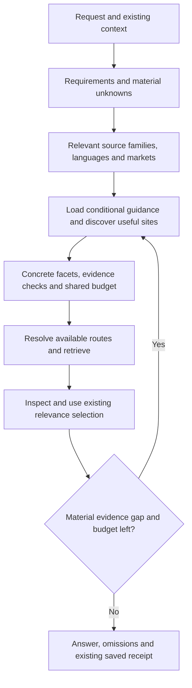

# Search source selection and broad exploration

Teach `utils-agent:search` where useful evidence is likely to live, why a source
fits a request, and when to expand into other communities, languages or buying
channels. Preserve the shared engine's budgets, optional access, relevance
selection and durable diagnostics. Sources remain discoverable beyond a curated
list, without requiring a dedicated adapter or a self-hosted index for each site.

This is the follow-up to the [shared search plan](search-skill-plan.md), not a
replacement for its outstanding quality gates. [ADR 0055](../adr/0055-search-sources-independent-of-providers.md)
records the source/route boundary; [ADR 0054](../adr/0054-shared-search-engine.md)
continues to own shared execution and specialized-consumer ownership. This plan
specifies the implemented 1.16.1 behavior. Its examples do not apply to the 1.15.0
baseline unless explicitly described as existing.

## Delivery status

The [qualification record](../research/search-source-selection-qualification.md)
owns current evidence and limitations. The Fable revisions were incorporated;
source resolution, metadata/diagnostics, conditional guidance, compatibility and
consumer changes are implemented. Opus reviews prompted fixes, with 96 portable
tests and the consumer suite passing. The 1.16.1 corrections preserve legacy
source/required-source extensions, reject ambiguous Unicode hosts, clarify regional
Amazon scopes, and make area errors actionable. Five public cases were attempted in three
conditions and three repeats: 45 attempts, including two invalid executions kept
as failures. Separate canaries and an identical-observation redirect replay verify
the corrections. Package activation is recorded separately in qualification.

The pilot does not establish a quality winner: all shopping and valid Codeberg
attempts remain partial; original-language accuracy and hidden-family generalization
are unmeasured. This plan stays active for that wider qualification alongside the
parent plan's quality gates. No new source adapter, provider ranking change or
additional spend follows from the small sample. Durable behavior is already in the
skill and accepted ADR; historical baseline observations below are retained as such.

## Baseline reread

The planning pass began with a clean worktree on `prateek/best-search-api` at
`7c76225d` (`feat(search): add relevance selection and durable diagnostics`), after
`cd29deee` introduced the shared engine. The baseline authored utils-agent version was
**1.15.0**. These are source observations, not a new activation or live-provider
qualification. The [qualification record](../research/search-skill-implementation.md)
owns historical test and runtime evidence.

| Existing behavior | Consequence for this work |
| --- | --- |
| Host-owned `intent`, facet checks and relevance labels: direct, partial, adjacent, irrelevant, unassessed | Extend source planning; keep the existing assessment vocabulary and authority boundary |
| Fetch limit, visible candidate page and final shortlist limit are separate; the saved pool is pageable | Wider exploration must not restore an early popularity or display cutoff |
| `select` saves evidence-backed candidate assessments and ordered shortlists; changed evidence invalidates stale judgments | New sources feed the same selection procedure |
| Automatic private XDG state, transport events and compact answer receipts | Add exploration context to the existing trace, not another logging system |
| `extend` accepts additional discovery and inspection jobs in the original run | Adaptive exploration uses the original budget, deadline and authorization |
| Three prior review defects are fixed: date conflicts, retry coverage and suppression causes | Preserve those regressions while changing routing |
| `skills-searcher --relevance` uses prepared jobs, independent fetch limits and the shared run | Keep the consumer's query policy and output compatibility; avoid a second generic routing pass |
| Reported follow-up evidence: 66 portable tests, consumer checks, 104 marketplace tests and seven archived-pool replays | Recorded qualification, not tests rerun by this planning pass; replay does not establish better task quality |

The baseline limitations were concrete:

- `contracts.SOURCES` is a closed map from source ID to one area and domain.
  Unknown source IDs and a known source used in another area fail validation.
  Unregistered sites already work through `source=web` plus `filters.domains`;
  the resolver adds consistent source identity, constraints and cross-area use.
- `planning.supports` checks literal membership in each adapter's source list.
  General web adapters copy the entire source map into their declarations.
- `planning.plan` silently chooses HN for social, Amazon for shopping and GitHub
  for code when only an area is supplied. The CLI performs no semantic intent routing.
- `adapters.web.keywords` and `engine.source_matches` consult that fixed map.
  Query translation, URL filtering and identity all need consistent source resolution.
- Social and shopping references explain verification more clearly than source
  selection. They lack regional, multilingual, used-equipment and auction guidance.
- `intent` currently accepts only request, requirements and hard constraints.
  It cannot structurally record context assumptions or considered search branches.
- `filters.language` already serves programming-language filters. It must not be
  repurposed as the human language of a query or result.

The main owning files are [contracts](../../agent-marketplace/packages/utils-agent/skills/search/scripts/searchlib/contracts.py),
[planning](../../agent-marketplace/packages/utils-agent/skills/search/scripts/searchlib/planning.py),
[engine](../../agent-marketplace/packages/utils-agent/skills/search/scripts/searchlib/engine.py),
[identity](../../agent-marketplace/packages/utils-agent/skills/search/scripts/searchlib/identity.py),
and the [selection reference](../../agent-marketplace/packages/utils-agent/skills/search/references/selection.md).

## Outcome and scope

A broad request should produce a justified, bounded set of complementary searches.
The agent should consider specialist and local-language sources, use existing
retrieval routes where possible, inspect evidence, and explain material omissions.
A narrow request should remain inexpensive and direct.

Success includes all of the following:

1. Source choices respond to evidence needs and relevant user context rather than
   a fixed platform default or the credentials currently available.
2. Public web sources absent from the seed catalogue can be searched and inspected
   through eligible existing routes, with accurate identity and coverage.
3. Social, shopping, code and web remain evidence areas; a platform can contribute
   to several areas without duplicating its transport implementation.
4. Multilingual queries preserve entities and original evidence, with explicit
   language, market and translation limits.
5. Shopping includes used, refurbished, wholesale, local, surplus and auction
   channels when condition, quantity and logistics justify them.
6. Existing relevance decisions, receipts, privacy/retention handling, prepared
   consumers, budgets and resume semantics remain intact.
7. Paired evaluations establish the benefit and cost of added guidance separately
   from the benefit of new retrieval capabilities.

This work does not provision accounts, purchase access, transact, operate an
index, promise full platform coverage, or build an adapter for every named site.
Native adapter additions follow observed capability gaps and separate qualification.
Portable instructions contain no personal account, vault, machine or employer
conventions. No geography, language or tolerance for used goods is hard-coded as
the user's preference.

## Vocabulary and ownership

| Term | Meaning and owner |
| --- | --- |
| Area | Evidence policy: web, code, social or shopping; chosen by the host from the task |
| Source | Underlying publisher, platform, community or scoped site; independent of retrieval service |
| Source family | A planning aid such as technical community, official documentation, local classifieds or government surplus; not another engine or adapter |
| Provider | Executable retrieval service/adapter, such as Serper or HN Algolia |
| Upstream | Known index/data provenance behind a provider; unknown stays unknown |
| Method | API, native CLI, host tool or browser |
| Operation | Requested discovery/read/inspection capability; source awareness does not establish support |
| Facet | One evidence need represented by a concrete source/operation job and checks |
| Exploration decision | Concise host-authored explanation of a considered source family, language or market and its disposition |
| Source profile | Conditional guidance about task fit and evidence limits; not a promise of current access |

Use the current glossary's search run, candidate pool, shortlist and receipt terms.
Add the new durable terms to `GLOSSARY.md` during implementation. Explain the small
area/source/provider/upstream distinction in `references/source-selection.md` so it is
available without reading a repository plan.

The host chooses evidence and search branches using its existing reasoning.
The deterministic planner validates concrete jobs and resolves eligible routes.
The engine does not add an LLM service, translate queries, infer user geography,
or assign semantic source/relevance scores. Specialized consumers keep domain
query policy and ranking; generic improvements return to the parent skill.

## Source-selection workflow



### Establish context without a questionnaire

Use explicit instructions, applicable conversation context and deliberately saved
preferences first. Record the origin of material facts. Infer low-impact defaults
only when they are useful and reversible; distinguish an assumption from a fact.
Ask a focused question when an unknown changes feasibility or the recommendation,
while continuing independent research that does not depend on it.

Relevant dimensions include evidence purpose, recency, audience, answer language,
search languages, geography, delivery market, currency, budget, condition,
quantity, compatibility, deadline, pickup, imports and warranty expectations.
Gather only dimensions relevant to the task. A purchase's delivery market matters;
the user's nationality usually does not. Private addresses stay in an authorized
session, not source profiles or reusable preferences.

Unknown context may permit comparative discovery while blocking a definitive
availability or best-value claim. Ask before treating an expensive or irreversible
assumption as settled. Searching auctions does not authorize bidding.

### Choose complementary branches

Read the applicable area guide, select source families, then load region or
specialist references whose triggers fit. Begin with a small complementary set:
primary evidence, relevant experience or specialist evidence, and an alternative
channel when it can change the answer. This is a heuristic, not a mandatory
three-source quota.

Consider evidence value before access cost, then choose feasible routes within
the budget. Missing access should yield a visible gap or a useful alternative,
not redefine the user's question. Source profiles are starting points. Follow
citations and discover additional forums, official portals or sellers when the
known list is inadequate.

Keep three breadth intents in guidance: focused lookup, ordinary comparison,
and wide exploration. Wide exploration requires a stated scope of relevant
families/languages/markets and rationale for omitted major branches. It never
means querying the whole catalogue or silently raising call limits.

Explain provider fit as well: native structured search for qualified operations,
keyword discovery for exact identifiers, semantic discovery for conceptual needs,
and browser inspection for evidence the index cannot supply. These are provisional
roles, not measured provider rankings. Inspect supported filters, known upstream,
observed yield and cost before choosing a route. Where local-language coverage is
weak, consider a relevant regional search service, such as Naver, Baidu, Yahoo!
Japan or Yandex, through an actually available route. Naming one in guidance does
not add an adapter, establish independent indexing or prove regional coverage.

### Expand and stop deliberately

Use `extend` when weak results, conflicting evidence, untranslated terminology,
an uncovered requirement or a newly identified source justify another search.
Keep discovery, enrichment and inspection under the existing run. Budget some
inspection before discovery; scale the allocation explicitly for broad tasks.
The current three-call default cannot support a large regional comparison. For
example, three discovery facets plus two inspections need at least five calls,
three discovery slots, two enrichment slots and two opens; reserve any retry
allowance separately and size the deadline from observed route latency.

Starting sources belong on facets. Global source, area, provider and method choices
remain binding restrictions across extension. A host choosing to start on Reddit
uses a Reddit facet without a global source pin; a user requiring only Reddit gets
that pin. Additional facets may broaden an unpinned run within its original limits.
A material change to user requirements requires explicit scope handling and
reassessment; extension never changes those requirements or resets a budget.

Stop when requirements have inspected support or explicit unresolved gaps and
further plausible branches would not change the answer, or when budget/access
prevents progress. Record the stopping reason. Repeated results through a shared
index, syndicated articles, mirrors, reposts and translations do not establish
independent corroboration. Source count is never the success criterion.

## Guidance layout and source profiles

Keep the main skill close to its current size by replacing vague source-selection
sentences with a short workflow and explicit pointers. Preserve the required
selection/receipt reference; do not duplicate its ranking procedure.

| Planned home under `search/` | Trigger and content |
| --- | --- |
| `SKILL.md` | Every invocation: context, area selection, conditional pointers, evidence and budget completion criteria |
| `references/source-selection.md` | Source/provider vocabulary, family selection, breadth, expansion and stopping |
| Existing `references/{web,code,social,shopping}.md` | Area-specific source-family choices plus the existing verification rules |
| `references/multilingual.md` | A non-default language, relevant regional community, cross-border market or broad international comparison |
| `references/regions/east-asia.md` | Chinese-, Japanese- and Korean-language ecosystems and market distinctions |
| `references/regions/global-discovery.md` | Find local sources across other regions, including Africa, South/Southeast Asia, Latin America, Europe and the Middle East; seeds are illustrative |
| `references/shopping/used-and-auctions.md` | Used/refurbished, surplus, liquidation, auction or bulk-lot requests |
| `references/shopping/sourcing-and-delivery.md` | Wholesale/import sourcing or location/time-dependent grocery and delivery offers |
| Existing `references/options.md` and `references/extending.md` | Executable contracts, compatibility and extension ownership |
| Existing `references/selection.md` | Relevance, inspection, shortlist and receipt; link to new exploration data rather than restating it |

Start with these branch-sized references, not one file or skill per platform.
Split another file only when a recurring branch has enough distinct guidance.
The pointer must name its triggering condition. Test whether agents actually read
the applicable file instead of assuming a link is sufficient.

A useful source profile contains: task-fit triggers; likely evidence; poor-fit
conditions; language/market/community scope; discovery versus inspection limits;
checks that change the decision; complementary sources; and references for unusual
or time-sensitive claims. Record the verification date for access-related notes.
Live capability and provider metadata stay in the adapters; profiles refer to
`capabilities` rather than duplicating key names, quotas, prices or readiness.

Track source awareness, supported operation, local readiness, observed access and
answer coverage separately. A known source with an untested route remains a
candidate for exploration. A working URL read does not qualify platform search,
comments, transcripts or inventory completeness.

## Initial source coverage

The tables are proposed seed coverage, not an exhaustive site list, measured
quality ranking or claim of working integrations. Each shipped entry must explain
a useful decision. Remove names that add no distinct guidance. Discover relevant
sources beyond the seeds during actual searches.

### Social and communities

| Evidence family | Seeds | Guidance to include |
| --- | --- | --- |
| Public conversation and announcements | X, Bluesky, Threads, Mastodon | Original author, date, replies, repost lineage; federation/instance limits where relevant |
| Experience, troubleshooting and Q&A | Reddit, specialist forums, Discourse, Stack Exchange, GitHub Discussions | Concrete environment, versions, firsthand evidence and follow-up; anecdotal reports do not establish prevalence |
| Technical news and discussion | HN, Lobsters, regional technical communities | Inspect original links separately from summaries and community interpretation |
| Professional and industry experience | LinkedIn, practitioner blogs/newsletters, professional associations | Relevant authorship, firsthand work and promotional context |
| Demonstrations and audiovisual claims | YouTube, TikTok, Instagram, Bilibili, Douyin | Actual video/transcript/image evidence, identity and context; engagement is not verification |
| Local and interest communities | Facebook groups, local forums and community platforms | Community and geographic fit; public or already authorized access |
| Messaging/community archives | Public Telegram channels, public mailing lists, available Discord/Slack archives or authorized connectors | State the actual community and searchable scope; access to one does not imply platform-wide search |

Keep counts and observation times in their native meaning. A view, like, vote,
comment and follower are different signals. Promotional selection effects,
moderation, ranking and incomplete indexing limit representativeness.

### Language and regional seeds

| Context | Seeds | Distinctions that matter |
| --- | --- | --- |
| Simplified Chinese communities | Weibo, V2EX, Zhihu, Tieba, Juejin, Bilibili, Douyin, Xiaohongshu/Rednote | Microblogging, technical communities, Q&A, video and consumer experience have different roles |
| Traditional Chinese communities | PTT, Dcard, Mobile01, LIHKG | Separate community, language variant and purchasing market; avoid treating all Chinese-language evidence as one region |
| Japanese communities | X, Hatena Bookmark, Qiita, Zenn, note, 5ch, specialist forums | Engineering articles, link discussion, personal accounts and anonymous threads |
| Korean communities | GeekNews, Naver Blog/Cafe, Daum Cafe, Clien, DC Inside | Technical news, professional writing, local knowledge and community discussion |
| Other regional ecosystems | Habr, Pantip, Kaskus, Nairaland, regional specialist forums and local-language communities on global platforms | Discover by the specific topic and language; this list does not stand for every country or community |

Use functions rather than declaring exact national equivalents of a US platform.
GeekNews explicitly cites an HN inspiration; V2EX and Zenn have different
community formats. Regional profiles are suggestions about where to look, not
claims about a population or the nationality of an author.

Multilingual execution preserves entity names, versions, model numbers and native
spellings. Generate native-language terms and aliases when useful; keep the exact
sent query and its language in the trace. Distinguish query language, requested
result language, observed content language and answer language. Native-language
queries are usable even when a provider lacks a language filter; a strict result-
language restriction still requires supported filtering or inspected verification.
Never silently drop a hard filter or overload the programming-language field.

Retain original evidence and URLs, label translations and unresolved ambiguity,
and normalize time/currency/units only with an explicit basis. A translated query
does not prove product equivalence, shipping eligibility or independent evidence.
Unknown translation quality remains a limitation, especially for narrow technical
terms. Use native-readable reviewers for evaluation where available.

### Shopping channels

| Channel | Seeds | Selection and verification |
| --- | --- | --- |
| Manufacturer and authorized retail | Manufacturer stores, distributors, local specialists | Specifications, compatibility, warranty, stock and a new-price baseline |
| General retail and regional marketplaces | Amazon, eBay, Rakuten, Mercado Libre, Coupang, JD, Taobao; locally relevant retailers | Seller, variant, market, fulfillment and return terms |
| Cross-border consumer retail | AliExpress and relevant overseas retailers | Small-quantity fit, delivered cost, lead time, compatibility and returns |
| Wholesale and sourcing | Alibaba.com, 1688, Global Sources, specialist distributors | Quantity/MOQ, quotation basis, samples, shipping and buyer eligibility |
| Refurbished and ex-enterprise | Manufacturer outlets, refurbishers and IT asset-disposition sellers | Testing/grading, health evidence, warranty, accessories and exact model |
| Peer-to-peer/local | Facebook Marketplace, Craigslist, OfferUp, Mercari, Karrot/Daangn, Carousell, Xianyu and regional classifieds | Location, pickup/shipping, condition and individual seller evidence |
| Government/institutional surplus | GSA Auctions, GovDeals, Public Surplus, GCSurplus, Zoll-Auktion, university and municipal surplus | Actual lot, condition, eligibility, fees, deadline, pickup/removal and shipping |
| Commercial liquidation and auctions | HiBid, BidSpotter, Troostwijk, Surplex, local auction houses | Manifest versus working inventory, inspection rights, buyer premium, removal labor and provisional bid |
| Specialist resale/auctions | Category-specific camera, audio, instrument, collectible and industrial marketplaces | Authenticity, provenance, condition and specialist inventory; apply only for a matching category |
| Deal and comparison discovery | Regional deal forums, price trackers, comparison services and completed sales | Leads and historical context; verify the current seller offer and distinguish asking/bid/sold prices |
| Grocery and local delivery | Retailer-direct sites and relevant regional delivery platforms | Authorized service address, stock, fees, time window and substitution policy |

Regional market guidance should include local discovery when the seed list is
weak: for example, compare relevant marketplaces/classifieds in Latin America,
South/Southeast Asia, Africa, Europe and the Middle East. Country selection must
follow fulfillment context, not the runtime machine or currency of a search API.

Separate current listing price, auction bid, quote, reserve and completed-sale
price. Compare total delivered cost and evidence confidence while preserving
variant, seller, condition, location and observation time. Unknown fees remain
unknown. A cheap untested lot is not a guaranteed quantity of working products.

### Web, code and other evidence

| Need | Sources/families to consider |
| --- | --- |
| Implementation and maintenance | GitHub, GitLab, Codeberg/Forgejo, SourceHut, Gitee, project-hosted repositories, issues, discussions and mailing lists |
| Dependencies, releases and compatibility | Native package registries, release notes, distribution repositories, advisories and official documentation |
| Models and datasets | Hugging Face, original projects/papers, institutional and public dataset catalogues |
| Technical/research claims | Papers, institutional repositories, standards bodies, patents, primary technical reports; distinguish access to metadata from full text |
| Public records and facts | Relevant statistical agencies, regulators, registries, public datasets and filings |
| News and historical context | Original/local-language reporting, specialist publications, archives and primary announcements |
| Practical knowledge | Maintainer/practitioner blogs, issue trackers, specialist communities and regional technical writing |

These remain families within the four existing areas. A later literature or
procurement skill may add domain decisions and output requirements while reusing
shared retrieval. A new platform name alone does not justify a new skill.

## Executable source contract

### Explicit site scopes and multiple areas

Retain named source aliases and add a data-only source reference of the proposed
form `site:<hostname>[/path-prefix]`, for example `site:zenn.dev` or
`site:example.org/community`. Validate the explicit prefix so a typo in a named
source does not silently become a new platform. Existing names keep their meaning.
Resolve known aliases and explicit scopes through one source resolver shared by
planning, adapters, filtering and identity. No custom endpoints, commands or
credential declarations enter through source references.

Treat area as facet evidence policy. Validate area/operation compatibility
separately from source identity; preserve concrete provider operation constraints.
For example, a GitHub Discussion may support social evidence while repository
code supports code evidence. A video platform may support a product offer only
through an actual offer-capable route. A catalogue entry cannot grant an operation.

General web providers expose `source_scope: public-web`, an empty named-source
list, and `scope_filter: query|native-scope|destination` to describe request
translation rather than a guarantee of upstream adherence. Native providers expose
`source_scope: named` and their explicit aliases. Host bindings can narrow scope
support. A `probe` facet supplies the bounded doctor target; providers without a
discovery probe require an explicit inspection request. Capabilities advertise
feature names and the engine version. No new scope label changes provider ranking
without qualification evidence. General web support applies only to qualified
operations; native/vertical providers keep explicit supported sources
and operations. This replaces copying every source into every general adapter.
Configured browser/fetch bindings still declare their real operations. A generic
site never acquires native comments, transcript or global search support by name.

Normalize DNS names, IDNs and allowed path scopes once. Specify subdomain and
path-segment matching; reject credentials, malformed authorities and query/fragment
syntax in source references. Distinguish a scope from an inspection URL. Preserve
path case and meaningful URL parameters. Known short-link aliases remain explicit.
Apply source scope and user filters as an intersection, not a widening union.
Verify returned destinations; an index's `site:` syntax is not proof of adherence.
Resolve include/exclude/require-source constraints against the same canonical
scopes: excluding `reddit` must also exclude `site:reddit.com` and its covered
subdomains. An alternate alias cannot bypass a user exclusion or satisfy a
required source with evidence from another host. Apply these checks during both
initial planning and extension, including when an inspection follows a redirect.

Preserve identity across alias and site-scoped discovery of the same resource.
Resolve known platform identity from verified URL structure rather than only the
requested source label. For unknown sites, use conservative canonical URL identity.
Keep requested scope and observed host/provenance separately. Preserve federated
instance identity, localized offers, versions, variants and sellers. Unproven
redirects, mirrors or translations remain separate observations/candidates as
appropriate; broadening must not produce either duplicate shortlists or false merges.

### Context and exploration records

Extend the existing version-1 request additively with optional context and source
decision data. Keep old explicit requests and prepared jobs valid. The first
contract slice fixes the public names and validates examples before adapters change.
The intended minimal shape is:

```json
{
  "schema_version": 1,
  "intent": {
    "request": "Find Korean developer discussions of open-source speech recognition",
    "requirements": ["Korean community discussion", "inspect original content"],
    "hard_constraints": [],
    "context": [
      {"name": "answer_language", "value": "en", "origin": "explicit"},
      {"name": "search_languages", "value": ["ko", "en"], "origin": "assumption"}
    ],
    "breadth": "wide"
  },
  "source_decisions": [
    {
      "id": "korean-tech",
      "family": "technical-community",
      "sources": ["site:news.hada.io"],
      "reason": "Korean-language technical discussion relevant to the request",
      "disposition": "selected",
      "facet_ids": ["discussion"]
    }
  ],
  "facets": [
    {
      "id": "discussion",
      "area": "social",
      "source": "site:news.hada.io",
      "operation": "post.discover",
      "terms": "오픈소스 음성 인식",
      "query_language": "ko",
      "needs": ["content", "date", "community"],
      "limit": 8
    }
  ],
  "budget": {"calls": 6, "discovery": 3, "enrichment": 3, "opens": 3, "wall_seconds": 180}
}
```

Context values are bounded public scalar/list data with origin: explicit,
conversation, host-held saved preference (when available) or assumption. The
engine does not provide a user-context store or assume host memory is available. Hard constraints retain their
existing authoritative list and assessment semantics; context metadata cannot
relax them. Breadth guides the host and does not enlarge engine budgets. Query
language describes the submitted text, not a claim of provider filtering.

Source decisions record only considered branches. Planning dispositions are
selected, not relevant, excluded by user, or deferred. Attempt outcomes, readiness,
budget exhaustion and relevance exclusions are derived from engine/selection facts,
not independently asserted in this record. Validate decision IDs and facet links.
Keep reasons concise and evidence-oriented; private reasoning is not trace content.

Allow append-only new source decisions alongside new jobs through `extend`.
Keep unique decision IDs and facet links; defer a supersession graph. A new row can
record a reconsidered branch with its new reason and facets. Preserve
the original intent, choices and all execution limits. New facts that materially
change requirements require an explicit scope amendment/reassessment workflow;
do not silently rewrite the initial intent in this first slice. Minor observed
context can be recorded in decisions without changing hard requirements.

Apply existing redaction and restricted-retention rules to every new field,
including source decisions that may mention retrieved content. Avoid recording
private addresses or account identifiers. Preserve the 8 MiB checkpoint failure
boundary and bounded candidate access rather than retaining arbitrary response dumps.

### CLI and compatibility

Expose executable controls through the current CLI rather than a new wrapper:

```text
agent-search query "オープンソース 音声認識" --area=web --source=site:zenn.dev --inspect
agent-search query "repair experience" --area=social --source=reddit,site:example.org/forum --inspect
agent-search query "SSD surplus" --area=shopping --source=site:example.org/auctions --operation=product.discover --inspect
```

Add `--operation` as an explicit discovery-only query control. Inspection/read
operations continue to use structured jobs with a URL or native item identifier. Keep context and breadth in the
structured request/natural-language workflow initially; avoid flags that imply
the standalone CLI performs translation or semantic source selection. Add aliases
later only when they have a clear, tested caller-visible effect.

For new requests, a bare query still means general web discovery. An area alone
does not choose HN, Amazon or GitHub: require explicit sources/facets or an
unambiguous pinned route with one qualified named source. Return an actionable source-selection error
without calls. A general-web fallback was considered: it avoids an error but
changes implied coverage without selecting an evidence source. Keep the explicit
error for non-web area-only requests; the host selects ordinary starting facets.
Mixed area/source shorthand is ambiguous and requires structured facets. A known-source shorthand may retain its documented discovery
default; explicit `--operation` resolves ambiguous uses such as videos versus posts.
The host normally supplies facets, so this does not require questioning the user
for routine source choices. Prefer structured facets for mixed areas/operations.

| Existing interface | Required compatibility |
| --- | --- |
| Explicit named-source requests and consumer prepared jobs | Preserve transport, selection and budgets; contradictory source/require-source pins now fail, and new native GitHub runs enforce github.com instead of trusting arbitrary result hosts |
| Area-only new requests that formerly selected a platform | Intentional documented behavior change; explain the source/facet remedy and show it in CLI help |
| Saved preferences | Preserve pins, precedence and free-only constraints; validate site scopes; never persist inferred context automatically |
| Existing checkpoints | Remain readable/reportable and settle pending work once using their legacy identity policy; preserve IDs/digests and reservations. Extension accepts baseline-compatible jobs; new site/cross-area semantics require a new explicitly scoped plan using only the remaining authorized allowance |
| Existing unexecuted plans | Re-resolve safely; fail with a re-plan instruction when old implicit choices or changed capabilities no longer match |
| New fields read by an older binary | Fail clearly; package consumers and engine together, with feature/version information in capabilities |
| Capability inventory and doctor | Keep local inventory free of source calls; define explicit bounded probe targets for generic providers rather than relying on the first source in an enum |
| Skills-searcher | Continue using matching sibling CLI and explicit jobs; preserve TSV/JSON compatibility, legacy metric view and relevance mode |

Keep schema version 1 only for additive fields and unchanged existing representations.
If implementation needs a representation change or cannot safely resume a baseline
checkpoint, stop that slice and document a versioned migration in the proposed ADR
before coding around it. Never silently reinterpret an old run or replay it.

## Diagnostics and selection integration

Use the current XDG state/events and receipt. Extend them with context origins,
considered source families, query languages, market scope, source decisions,
expansion links and stopping reason. Make each added job traceable to a requirement
or exploration decision. Preserve exact expanded/translated queries where retention
allows, alongside observed content language when inspected.

Join planning and execution facts so the answer can distinguish: irrelevant branch,
user exclusion, not attempted within budget, unavailable access, attempted empty,
retrieved but irrelevant, and inspected supporting evidence. These are distinct
dimensions; they should not replace current transport statuses. The agent decides
semantic usefulness using existing labels. No numerical source or relevance score
is introduced.

Add an optional concise coverage sentence to the existing receipt when languages,
markets or omitted channels materially affect the answer. For example:

```text
Coverage: Japanese and English technical sources; Japanese originals inspected;
          one community unavailable. Broader regional search stopped at the call cap.
```

This is a format example, not an observed run. Counts still come from the existing
receipt scaffold. The trace contains the extended detail; the answer need not list
every catalogue entry. Retention omissions, failed writes and unknown measurements
remain explicit. Reuse relevance ordering: hard constraints, task fit, inspected
evidence and appropriate authority, then secondary signals. Source diversity is
useful when it adds evidence; it never promotes an irrelevant result.

## Worked acceptance scenario: inexpensive used SSDs

For a public example requesting four compatible SSDs with used acceptable:

1. Resolve interface/form factor, capacity, delivery market, deadline, total budget,
   warranty expectations, pickup and lot tolerance. Ask only material missing facts.
2. Compare a new-retail baseline, refurbished/ex-enterprise sellers and relevant
   used marketplaces. Consider auctions/surplus if quantity and removal terms fit;
   consider cross-border retail or wholesale if delivered economics and lead time fit.
3. Inspect model, compatibility, health/testing evidence, seller, return/warranty
   terms, stock/lot count and total delivered cost. Keep unknown condition unknown.
4. Distinguish a bid from a final price, an untested lot from working units, and
   an asking price from a completed sale. Do not invent a failure probability.
5. Use existing selection labels and save the source/channel decisions. A low
   nominal price fails a hard interface or delivery constraint regardless of platform.

Run a contrasting one-drive/urgent/new-only case. It should narrow exploration
and explain why auctions or wholesale are poor fits. This prevents the broad
catalogue from turning every buying request into a long sourcing exercise.

## Delivery sequence

| Slice | Work and owning surfaces | Completion evidence |
| --- | --- | --- |
| 1. Freeze baseline and contracts | Public baseline snapshots, proposed ADR, source-reference/operation/context examples; `contracts.py`, CLI help design and compatibility fixtures | Existing prepared jobs and saved-run cases captured; new requests fail for the intended baseline limitations; wire examples and migration choices reviewed |
| 2. Generalize source resolution | Small shared source resolver; planner eligibility, web query translation, host payloads, returned-URL filtering and identity | New domain works without registration; aliases retain identity; native-only operations remain constrained; no source/area false rejection |
| 3. Preserve and extend run records | Context/source decisions in request, plan, extension, state/report and existing diagnostics; receipt coverage | One run across expansion and inspection; accurate joins/omissions; old checkpoints and retention tests pass |
| 4. Author decision guidance | Main skill pointers, source-selection guide, four area guides, multilingual/regional and shopping references; glossary and extension ownership | Concrete triggers and completion criteria; compact common path; names have useful selection rules; no internal infrastructure conventions |
| 5. Qualify representative routes | Small authorized canaries for new site scopes, languages, cross-area use and shopping inspections | Each operation marked tested, failed, unavailable or unverified; source awareness never presented as native integration |
| 6. Evaluate guidance and task outcomes | Public development cases, frozen baseline comparison, multilingual assessment and independent holdout where possible | Marginal useful evidence, correctness, omissions, cost/latency and context load reported; regressions resolved or release-limiting gaps named |
| 7. Review, package and activate | Code simplification, writing-for-agents pass, adversarial review, affected plugin version bump, package checks and authorized activation | Review findings disposed; artifact includes new references; fresh-session smoke verifies behavior separately from source tests |

Slices may be split into reviewable landings. Keep a passing explicit-source path
throughout. A source catalogue can broaden before any new native adapter; route
work is prioritized by measured missing operations or recurring access cost.
Changing provider preference still requires evidence and inspection of the resolved
plan. This plan does not claim that registered providers have equal quality.

## Evaluation and validation

Follow [tests/README.md](../../tests/README.md) and the testing-philosophy skill.
Test caller-visible contracts through the CLI/request/result seams, substituting
external HTTP/process/browser boundaries. Observe regression failures before fixes.
Avoid tests that merely assert source names or prose phrases exist.

### Deterministic guarantees

| Guarantee | Representative cases |
| --- | --- |
| Open site scopes preserve constraints | Unregistered forum succeeds through qualified generic discovery; malformed scope, host suffix lookalike and wrong path are rejected |
| Scope intersection and aliases are correct | Source plus narrower domain/path never widens; registered short links and IDNs normalize consistently |
| Source constraints cannot be bypassed | Alias/site/subdomain/redirect variants preserve exclusions, pins and required-source checks across initial and extended jobs |
| Multiple areas preserve operation limits | Same platform supplies social and shopping jobs through eligible routes; unsupported comments/offer inspection remains a gap |
| Defaults are honest | Area-only request makes no calls and requests source selection; bare web and explicit native/source recipes still work |
| Identity survives broader discovery | Alias/site discovery merges one real resource while preserving observations; different instances, offer variants, revisions and translations avoid false merges |
| Language metadata is distinct | Korean terms reach transport unchanged; query-language metadata never becomes a code-language filter or an asserted result-language guarantee |
| One run owns expansion | Decisions and new discovery/inspection jobs preserve deadline, call cap, paid authorization and pending reservations |
| Diagnostics separate planning and execution | Deferred, excluded, unavailable, empty and irrelevant outcomes stay distinguishable; unmatched decision/facet IDs fail atomically |
| Old runs remain usable | Baseline checkpoint report, pending settlement, paging, selection and explicitly permitted extension preserve IDs and prevent replay |
| Existing selection remains valid | Full pool reachable; no popularity truncation; new evidence invalidates stale assessments; hard constraints retain precedence |
| Retention and persistence hold | New fields are redacted; restricted content cannot leak through decision prose; private paths, write failure and 8 MiB rejection retain existing semantics |
| Consumer behavior survives | Skills-searcher prepared jobs, no-enrich, raw/doctor, receipts, legacy display and relevance output retain their documented contracts |

### Agent-task cases

Use public prompts and explicit synthetic buyer context. The following are exposed
development cases, not a hidden test set. Add paired narrow/broad and sparse-access
variants rather than increasing source count for its own sake.

| Case family | Behavior to evaluate |
| --- | --- |
| Public conversation beyond X/Reddit | Threads/Bluesky/Mastodon considered when useful; actual scope/access stated |
| Professional or visual evidence | LinkedIn industry experience; TikTok/Instagram demonstrations inspected beyond captions |
| Chinese-language owner experience | Native terms and appropriate communities; language/market separated |
| Japanese technical troubleshooting | Qiita/Zenn or a discovered specialist source; exact versions and primary evidence |
| Korean technical discussion | GeekNews/Naver or a discovered community; summaries traced to originals |
| An underrepresented regional request | Local-source discovery beyond the seeded regions; no assumption of US availability |
| Multilingual duplication | Original and translated/reposted claims are not counted as independent corroboration |
| Used SSD purchase | Retail, refurb and appropriate surplus channels; total cost, condition and compatibility |
| Urgent/new-only SSD purchase | Narrower channels and bounded work; unsuitable lot/auction branches omitted |
| Non-US surplus purchase | Relevant local institutional/government channel and feasible fulfillment |
| Wholesale versus consumer order | MOQ, quantity, quotation and import differences change source choice |
| Address-dependent delivery | Evidence limited to the authorized service context; private address absent from trace |
| Code outside GitHub | Authoritative project host or registry discovered; identity and revision verified |
| Research/public records | Correct primary evidence family and jurisdiction, with access limits |
| Source absent from catalogue | Discover and search a new domain with no package edit |
| Sparse access and tight budget | Useful partial result, honest omissions, inspection allowance and no budget reset |

Compare three conditions: baseline 1.15.0; generalized contracts with baseline
source-selection guidance; and generalized contracts with new source-selection
guidance. Both generalized conditions receive identical CLI help, schema, options,
capability information and mechanics examples; only source-selection, regional,
multilingual and shopping decision guidance differs. Freeze these bundles before
running. The latter two isolate instruction value with the same capabilities. Also compare end-to-end performance
against baseline, explicitly recording the new-capability confound. Use fixed
model/harness settings, comparable budgets/access, paired repeated runs and
interleaved timing where live inventories move. Start with three repeats per
selected case, within existing authorization and a recorded live call allowance.
The initial pilot is used SSDs, urgent/new-only SSDs, a new domain, sparse access
and one language-specific case with a capable judge. Five cases, three conditions
and three repeats cap the pilot at 45 runs before separately bounded canaries.
Unrun families and language correctness without a capable judge remain unmeasured.
Prefer a smaller fully evidenced pilot when runtime access or allowance is limited;
record the exact shortfall instead of claiming a completed comparative evaluation.

Measure requirement coverage, inspected direct-fit evidence, newly useful source
families, unsupported claims, source-selection appropriateness, unnecessary
clarifications, context tokens loaded, calls/cost, latency and inspection yield.
Use blinded human or appropriately language-capable judgments where feasible.
Counts of websites or retrieved URLs are diagnostic, not quality outcomes.
Freeze acceptance rubrics before tuning; keep observed market changes separate
from implementation differences. Compare identical observations in offline tests
for deterministic mechanics, but never call that a live relevance improvement.

Release requires no critical failures (fabricated verification, lost hard
constraints, unauthorized/out-of-budget execution, private-data or retention
leakage), passing contract/consumer checks, and no unexplained case-family
regression. Publish wins, ties and losses with cost/context differences; small
samples do not establish statistical equivalence. Maintain an unexposed family
holdout only if an independent custodian is available; otherwise explicitly leave
generalization unmeasured. Respect provider benchmark/retention eligibility,
including the current Brave restriction in the selection/web guidance.

### Commands and evidence levels

Run these from the repository root as the implementation reaches each boundary:

```sh
python3 -m unittest discover -s agent-marketplace/packages/utils-agent/skills/search/tests
zsh agent-marketplace/packages/utils-agent/skills/skills-searcher/tests/skill-search.zsh
just -f agent-marketplace/justfile -d agent-marketplace check
just docs-inventory
just test-docs-lifecycle
DOCS_LIFECYCLE_BASE=origin/master just check-docs-lifecycle
git diff --check
```

Skill/parser/package checks prove structure and fixtures, canaries prove bounded
access, task evals address usefulness, and fresh-session tests prove activation.
Record each separately. The current qualification record separates newly executed
checks from historical evidence and failed or unmeasured cases.

## Maintenance and closure

Add a source profile when it changes selection or evidence checks. Add a source
alias/identity rule when recurring structured behavior warrants it. Add an adapter
when a new protocol or operation provides a demonstrated benefit. Prefer supported
existing web/browser routes for initial discovery. A failed route is not a reason
to create accounts automatically or to repeatedly retry a challenge.

Keep volatile access details dated and linked to primary documentation. Runtime
observations belong in traces/qualification, not permanent skill claims. Review
profiles after observed failures or changes; retire entries whose guidance adds
no useful branch. Preserve alternative source discovery when a platform changes.

The final implementation must reconcile this plan, the parent plan's remaining
quality gates, and the qualification record. Move durable behavior into the skill
and accepted ADR, repair consumer links, then retire this plan through the ledger
and regenerate the inventory. No plan closure is justified solely by passing
fixtures or producing a larger catalogue.

## Primary planning inputs

These support source-family distinctions from the preceding research discussion;
they do not establish current search access or a working adapter. Recheck volatile
operation details when authoring a profile or qualifying a route.

- [Mastodon search API](https://docs.joinmastodon.org/methods/search/): instance configuration and authentication affect search scope.
- [LinkedIn search](https://www.linkedin.com/help/linkedin/answer/a523136/search-on-linkedin): content categories and guest-access limitations.
- [V2EX](https://www.v2ex.com/about), [GeekNews](https://news.hada.io/about), [Zenn](https://zenn.dev/about), [Xiaohongshu](https://www.xiaohongshu.com/en): different regional community roles.
- [Alibaba.com](https://www.alibabagroup.com/en-US/about-alibaba-businesses-1747711844698554368) and [AliExpress](https://home.alibabagroup.com/en-US/about-alibaba-businesses-1747705938191581184): B2B sourcing versus consumer retail.
- [US government auctions](https://www.usa.gov/auctions-and-sales), [Public Surplus](https://www.publicsurplus.com/sms/browse/home), [Canada government sales](https://www.canada.ca/en/services/business/doing-business/buying-from-government.html), [Zoll-Auktion](https://www.zoll-auktion.de/auktion/): institutional surplus channels.
- [BidSpotter](https://www.bidspotter.com/en-us), [HiBid](https://hibid.com/), [Troostwijk](https://www.troostwijkauctions.com/), [Surplex](https://www.surplex.com/): commercial auction channels.
- [GitLab](https://about.gitlab.com/), [Gitee](https://gitee.com/), [Hugging Face Hub](https://huggingface.co/docs/hub/en/index): source families beyond GitHub and ordinary web pages.
